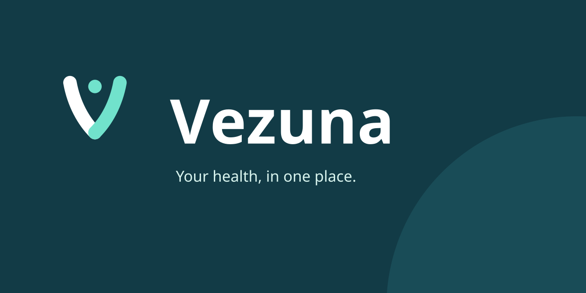
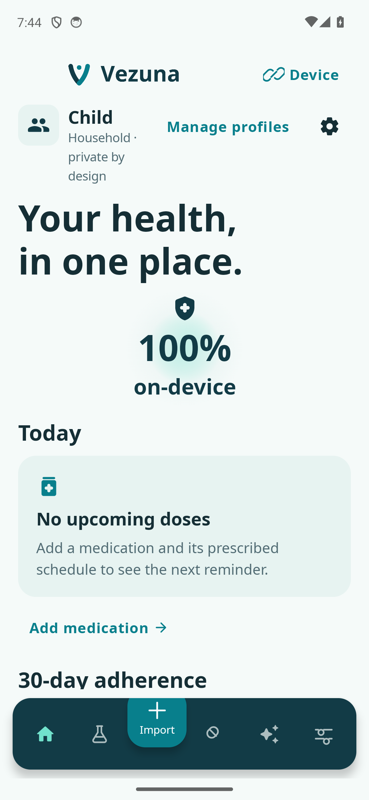
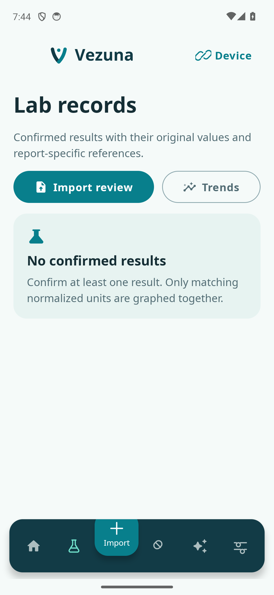
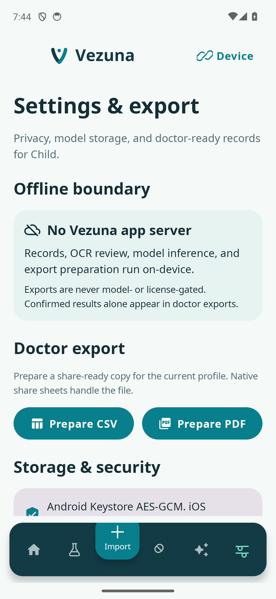

<p align="center">
  
</p>

# Vezuna

<p align="center">
  <strong>Your household's health records, together on your device.</strong><br />
  Lab reports, medication routines, and records to take to your next appointment.<br />
  Offline records and OCR · English, Portuguese, and Spanish
</p>

<p align="center">
  <a href="#see-the-app">See the app</a> ·
  <a href="#from-a-report-to-your-next-appointment">How it works</a> ·
  <a href="#build-it-or-help-out">Build or contribute</a> ·
  <a href="PRIVACY.md">Privacy</a>
</p>

Keep a separate profile for each person in your household. Bring in a lab report, check the extracted values, and follow confirmed results over time. When it's time for an appointment, prepare a PDF or CSV to share.

> Vezuna is open source and in **release preparation**, with Android as the first-release priority and a native iOS app in development. There is no stable release or public store download yet. See the [release guide](docs/RELEASING.md) for the remaining checks.

## See the app

These are real screens from the Android development app. Select an image to view it at full size.

<table>
  <tr>
    <th>Keep each person in view</th>
    <th>Review before you compare</th>
    <th>Prepare records to share</th>
  </tr>
  <tr>
    <td align="center"><a href="docs/images/android-home.png"></a></td>
    <td align="center"><a href="docs/images/android-labs.png"></a></td>
    <td align="center"><a href="docs/images/android-settings.png"></a></td>
  </tr>
  <tr>
    <td>Switch household profiles and see the day's medication area.</td>
    <td>Start an import review or open trends after confirming results.</td>
    <td>Choose a PDF or CSV export for the current profile.</td>
  </tr>
</table>

Unmodified Android emulator captures from **2026-10-31**, with synthetic profiles and records. These development screenshots do not establish physical-device behavior, iOS behavior, or store readiness. [Screenshot provenance](docs/images/README.md).

## Less searching when you need a record

- Keep household records separate. Switch profiles without mixing one person's reports with another's.
- Keep reports and everyday care together. Organize lab results, stored documents, and medication schedules with local reminders and dose history.
- Compare what you have checked. Trends use confirmed results and group compatible units together.
- Take a copy with you. Prepare PDF reports with tables and charts, export CSVs, or create a passphrase-protected backup. Records, backup, and export do not require AI or a store license.

## From a report to your next appointment

1. **Import a report.** Choose a PDF, select an image, or use the camera. Vezuna extracts embedded text or uses offline OCR.
2. **Check the details.** Review the draft against the original report. Correct values, units, dates, and reference ranges before confirming them.
3. **Compare over time.** Open the profile's confirmed results and trends. Results with incompatible units stay in separate series.
4. **Export for a visit.** Prepare a PDF or CSV and choose where to send it through the system share sheet. Lab exports use confirmed results.

Vezuna organizes your records. It does not diagnose, recommend treatment, or change doses. OCR can make mistakes, so always check imported values against the original report.

## Your records stay on your device

Health records are encrypted locally and separated by profile. The app has no account system or Vezuna application server, and app-owned code has no analytics, ads, or health-data HTTP client. Android removes the app's Internet permission.

Platform and store services have their own terms. A PDF or CSV you export is plaintext, and copies you share leave the app's protection. Keep backup passphrases safe; Vezuna cannot recover them.

Read [Privacy](PRIVACY.md) for Android Keystore and iOS Keychain storage, legacy-key migration and fallback, backup limits, and third-party behavior. The project makes no independent security-audit or clinical-validation claim. Report vulnerabilities through [Security](SECURITY.md), without posting health records publicly.

## Build it or help out

Vezuna uses Kotlin Multiplatform and Compose, with native Android integrations and an Xcode iOS app. You can help with import edge cases, translations, accessibility, documentation, or platform testing.

1. Read the [contribution guide](CONTRIBUTING.md). Use fictional data in issues, fixtures, and screenshots, and keep private health records out of the repository.
2. Follow [development setup](docs/DEVELOPMENT.md) for SDKs and platform builds. For Android host-test Java requirements and local verification, use [Local CI checks](docs/LOCAL_CI.md).
3. Start with the [architecture guide](docs/ARCHITECTURE.md), or discuss a proposed change in a [GitHub issue](https://github.com/bloodf/vezuna/issues).

For a first source check, run these from the repository root with Python 3:

```bash
python3 tools/localization/check_localization.py
python3 tools/branding/check_brand.py
python3 tools/lab_importer/test_importer.py
```

These checks cover catalogs, brand assets, and the synthetic importer. Native builds, Android host tests, device tests, and release gates are separate. See [Development checks](docs/DEVELOPMENT.md#checks) for suite-specific requirements, including the verified model fixture for inference tests.

<details>
<summary>Find your way around the native project</summary>

| Path | What's here |
| --- | --- |
| [`shared/`](shared/) | Domain logic, Compose UI, localization, import review, trends, vault contracts, and exporters. |
| [`composeApp/`](composeApp/) | Android app, encrypted storage, OCR, Health Connect, reminders, and native sharing. |
| [`iosApp/`](iosApp/) | Xcode app, SwiftUI integration, encrypted storage, Vision/PDFKit, HealthKit, and native sharing. |
| [`tools/`](tools/) | Importer, localization, branding, and release checks. |
| [`fixtures/lab_importer/`](fixtures/lab_importer/) | Synthetic importer examples and regression fixtures. |

</details>

## What's still being prepared

Local inference code is present, but first-release AI remains under validation. The shared [model catalog](shared/src/commonMain/composeResources/files/model-packs.json) is currently `[]`, so the default app has no model available. No production model memory budget or native build identity has been approved. Store model delivery, licensing, and physical-device performance still need validation.

Signed release candidates and development tests do not establish store availability or physical-device readiness. Follow the [release guide](docs/RELEASING.md) and [store review drafts](docs/STORE_REVIEW_DRAFT.md) for signing, model delivery, permissions, and remaining platform checks. Read the [tester-build identity transition](docs/RELEASING.md#moving-from-earlier-tester-builds) before moving data from an older build.

## More project guides

- [Architecture and data flow](docs/ARCHITECTURE.md) and [local verification](docs/LOCAL_CI.md)
- [Release and EAS submission](docs/RELEASING.md) and [changelog](CHANGELOG.md)
- [Website and public documentation brief](docs/MARKETING_AGENT_PROMPT.md)
- [Privacy and local storage](PRIVACY.md) and [third-party notices](THIRD_PARTY_NOTICES.md)

## Open source and licensing

Vezuna source code is [MIT licensed](LICENSE). The original [Vezuna artwork is also MIT licensed](brand/LICENSE), without trademark rights. The license does not permit presenting a fork as the official Vezuna app or implying endorsement.

Fonts, dependencies, SDKs, and model files retain their own licenses and terms; the full app payload is not all MIT. Read the [third-party notices](THIRD_PARTY_NOTICES.md) before distributing a build. Open-source licensing and any future paid store distribution are separate.
