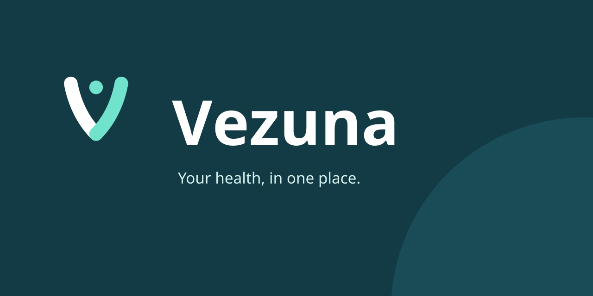
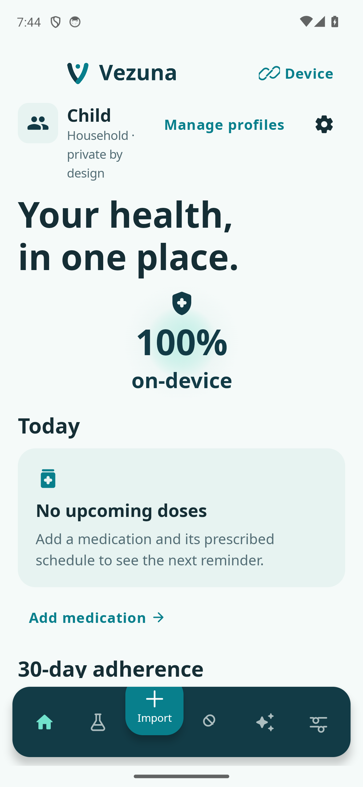
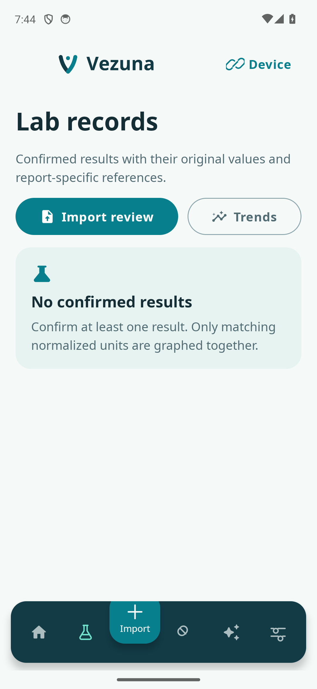
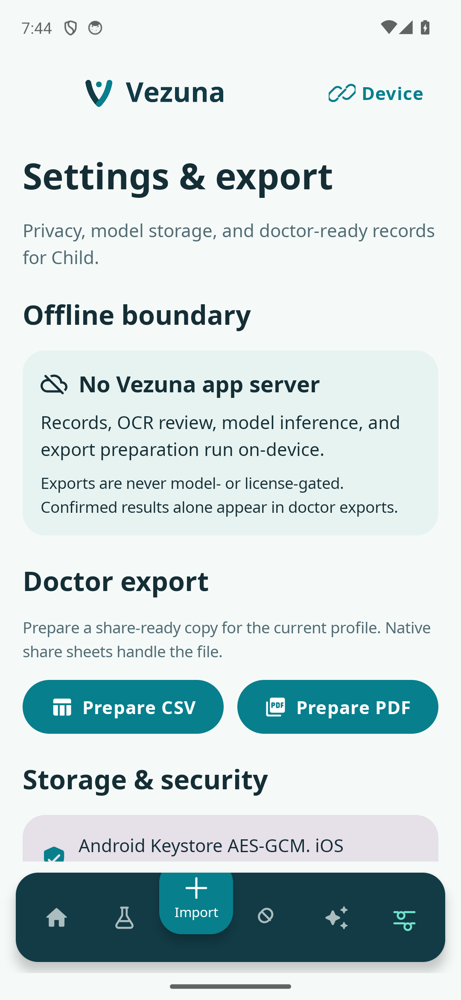

<p align="center">
  
</p>

<p align="center">
  <strong>Household health records, kept on your device.</strong><br />
  Native Android and iOS · Offline records and OCR · English, Portuguese, and Spanish
</p>

<p align="center">
  <a href="docs/DEVELOPMENT.md">Get started</a> ·
  <a href="docs/ARCHITECTURE.md">Architecture</a> ·
  <a href="PRIVACY.md">Privacy</a> ·
  <a href="docs/RELEASING.md">Release guide</a>
</p>

# Vezuna

Vezuna brings household profiles, laboratory reports, medication schedules, and exports into one offline app. Import a report, check the extracted values, and compare confirmed results over time. The app uses Kotlin Multiplatform, Compose, and native platform integrations. Its Android application ID and iOS bundle ID are `app.vezuna`.

Source code is [MIT licensed](LICENSE). Paid store distribution and open-source licensing are independent. Fonts and third-party components retain their own licenses; see [third-party notices](THIRD_PARTY_NOTICES.md).

Bundled licenses are available under **Device**, then **Third-party notices** on Android, and in the **…** menu on iPhone. Both menus also include an offline **Privacy policy**.

> **Release preparation.** Signed store builds, production model delivery, physical-device checks, and store review remain open. Vezuna organizes records; it does not diagnose conditions or recommend treatment. Confirm imported values against the original report.

## App preview

<table>
  <tr>
    <th>Household overview</th>
    <th>Laboratory records</th>
    <th>Privacy and exports</th>
  </tr>
  <tr>
    <td></td>
    <td></td>
    <td></td>
  </tr>
</table>

Actual Android emulator captures with synthetic test data. These are development-build screens. iPhone runtime and store-distribution checks remain pending. See [screenshot provenance](docs/images/README.md).

## Keep the record, check the details

| What you can do | How Vezuna handles it |
| --- | --- |
| Organize a household | Separate profiles, encrypted local records, and profile switching. |
| Bring reports into one place | Camera, images, and PDFs; embedded text and offline OCR; editable drafts, revision history, and duplicate checks. |
| Follow results and routines | Confirmed-result comparisons and trends, medication schedules, local reminders, and taken, skipped, or snoozed dose actions. |
| Prepare for a visit | Native PDF reports with result tables and charts, CSV exports, and the system share sheet. |

## Project guides

- [Development setup](docs/DEVELOPMENT.md) and [architecture](docs/ARCHITECTURE.md)
- [Native builds and Expo EAS submission](docs/RELEASING.md)
- [Store listing and declaration drafts](docs/STORE_REVIEW_DRAFT.md)
- [Marketing website and public docs agent brief](docs/MARKETING_AGENT_PROMPT.md)
- [Contributing](CONTRIBUTING.md) and [security reporting](SECURITY.md)
- [Privacy and local storage](PRIVACY.md)
- [Third-party licenses](THIRD_PARTY_NOTICES.md) and [changelog](CHANGELOG.md)

<details>
<summary>Native capabilities and implementation details</summary>

- Encrypted, profile-isolated health records and household switching.
- Camera, image, and PDF import with embedded-text extraction and offline OCR fallback.
- Structured unconfirmed OCR candidates, manual correction, revision history, and duplicate prevention.
- Longitudinal lab comparisons and confirmed-result trend graphs.
- Medication schedules, local reminders, taken/skipped/snoozed actions, and reboot/timezone rescheduling.
- Read-only Health Connect and HealthKit integration for heart rate, steps, and weight.
- Multiple local GGUF models with installation, streaming SHA-256 verification, selection, switching, deletion, and truthful loaded state.
- Fully local Llamatik inference; no AI service or app server.
- Device-language English, Portuguese, and Spanish across shared and native interfaces, notifications, permissions, errors, accessibility labels, plurals, and date/time presentation. Decimal-comma input preserves canonical stored values.
- Supplied Vezuna logo and native icons, local Noto Sans 400/700 with license, semantic light/dark themes, enlarged-text support, and reduced-motion-aware animations.
- Clinical lab-style PDF reports with exam sections, result/reference columns, status indicators, history tables, charts, and native sharing, plus CSV export.
- Store-mediated AI/model activation through Play LVL and StoreKit AppTransaction. Records and exports are never license-gated.

</details>

## Offline and privacy boundaries

There is no application server and no health-data HTTP client. Android removes Internet permission from the merged application manifest. Store services handle purchase verification and model-pack delivery without receiving health records.

Android uses a non-exportable AES-256 key in Android Keystore with AES-GCM. iOS uses CryptoKit AES-GCM and protected app-private files, not Keychain-backed key storage. See [privacy details](PRIVACY.md) for file protection, backup exclusions, and limitations. No independent security audit is claimed.

`BackupService` creates an authenticated encrypted profile envelope for same-device restore. Portable cross-device recovery requires a separately designed user-passphrase envelope; it is not claimed by this version.

The pre-release app identity changed to `app.vezuna`. It installs separately from builds with an earlier ID. Existing installations are not removed, and their encrypted data does not transfer automatically. See the [identity transition](docs/ARCHITECTURE.md).

Private source PDFs stay under the ignored `samples/` directory and are never build assets. Public importer and Android OCR tests use synthetic data.

## Native project layout

- `shared/`: domain, localized Compose UI and resources, encrypted-vault contracts, model lifecycle, comparisons, and PDF/CSV exporters.
- `composeApp/`: Android app, native resources, encrypted persistence, Health Connect, ML Kit/PDF import, reminders, Play LVL, Play Asset Delivery, and native sharing.
- `iosApp/`: Xcode app, localized SwiftUI/resources, encrypted persistence, HealthKit, PDFKit/Vision import, reminders, StoreKit, hosted asset loaders, and native sharing. Minimum supported iOS: 18.5.
- `tools/lab_importer/`: reference parser and synthetic golden/privacy regression checks.
- `tools/localization/`: catalog parity/completeness and nested JUnit result checks.
- `tools/branding/`: reproducible supplied-asset synchronization and brand/token/identifier checks.
- `fixtures/lab_importer/`: synthetic golden fixtures with no direct identifiers.

## Model-pack setup

The single catalog source is `shared/src/commonMain/composeResources/files/model-packs.json`, packaged into both the Android and iOS apps by Compose resources (no copies to keep in sync). It is `[]` until real store assets are configured; with an empty catalog the AI screens say the model is not available yet. To configure, replace `[]` with a JSON array of `ModelPack` objects (fields below) and run `:shared:jvmTest`, which parses the file. The project does not invent model URLs, asset IDs, sizes, or hashes. Every `ModelPack` requires a stable ID and GGUF filename, separate Android/iOS asset-pack IDs, exact size, minimum RAM, context limit, and lowercase SHA-256.

Play Asset Delivery and Apple-hosted asset packs/ODR require your developer accounts, signed catalog metadata, uploaded model packs, and store testing. Model selection verifies integrity with streaming SHA-256 on both platforms. AI/model activation may use store licensing; records, backup, and export never do.

## Build and verification

Requirements: JDK 17, Android SDK 37, macOS with Xcode for iOS.

```bash
python3 tools/localization/check_localization.py
python3 tools/branding/check_brand.py
./gradlew :shared:jvmTest :composeApp:assembleDebug :composeApp:testDebugUnitTest :composeApp:assembleDebugAndroidTest
python3 tools/release/stage_smoke_model.py models/qwen2.5-0.5b-instruct-q4_k_m.gguf
./gradlew :composeApp:connectedDebugAndroidTest
python3 tools/localization/check_test_results.py --instrumentation
python3 tools/lab_importer/test_importer.py
bash scripts/build-ios.sh
```

Android instrumentation requires a connected emulator or device and the hash-verified inference fixture described in [Development](docs/DEVELOPMENT.md#checks). Its committed OCR image and runtime-generated PDF use fictional data. The fixture is included only in the test APK. Device and store tests are separate release gates; successful compilation alone does not prove health permissions, notification delivery, or local-model performance.

## Release steps and known limits

- Configure Play LVL public key, App Store/Play signing, and real model-pack catalogs/assets.
- Run Play/App Store licensing and hosted-model download tests through the stores.
- Validate HealthKit, Health Connect, camera, notifications, OCR quality, and model performance on physical devices.
- Install an iOS simulator runtime or use a physical iPhone for iOS launch/runtime testing; the current environment has no iOS runtime installed.
- Verify actual elapsed notification delivery; workflow and scheduling tests do not prove wall-clock delivery on physical devices.
- iOS 18.5 is the minimum supported version, aligned with the bundled Skiko ICU object. Older iOS versions are unsupported.
- The JVM PDF exporter is an inspection fallback; production Android/iOS exporters preserve native Unicode rendering.

## Publishing with Expo

Vezuna stays Kotlin Multiplatform and native iOS; it is not an Expo/React Native app. EAS Submit uploads signed, externally built `.aab` and `.ipa` files. It does not build or sign these binaries, configure health permissions, or complete store review. Follow [RELEASING](docs/RELEASING.md) for account setup and commands. Never upload debug APKs, test APKs, private records, or unlicensed model files.

## Website and public documentation

The owner has purchased `vezuna.app` and connected it to Vercel. The planned marketing page lives at the domain root, with public documentation at `/docs`. The [website agent brief](docs/MARKETING_AGENT_PROMPT.md) covers the design, factual product copy, multilingual landing page, user and developer docs, accessibility, verification, and deployment.
