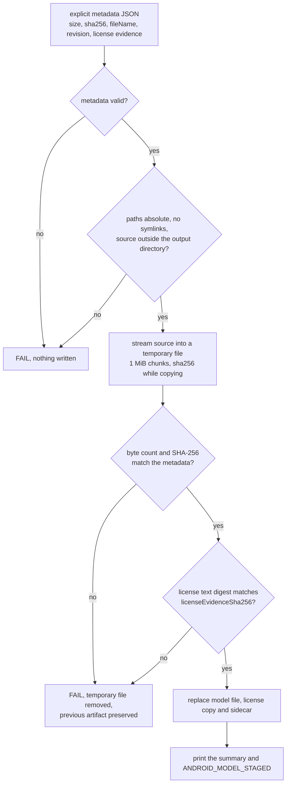

# Staging a production model for the Android asset pack

`tools/release/stage_android_model.py` copies one model file from a local source into an owned output directory, and it only replaces an artifact that already exists when the new bytes match the size and the SHA-256 that the caller stated in advance.

The tool exists so the Android release can carry a real model instead of the 0.5B test fixture. It is a staging step. It is not the delivery step.

## What this tool does

- Reads an explicit metadata document for the expected size, the expected SHA-256, the staged file name, the pinned upstream revision and the license evidence.
- Streams the source file into a temporary file in the output directory, computing the byte count and the SHA-256 while it copies, in chunks of 1 MiB by default. The file is never held in memory as a whole.
- Verifies the copy against the metadata before anything is replaced.
- Writes the model file, a provenance sidecar and a copy of the license text into the output directory.
- Removes only the temporary files it created. A failed run leaves every other file in the output directory untouched.

## What this tool does not do

- It does not download a model. The source file must already exist on the machine.
- It does not build the app, run Gradle, install anything or touch a device.
- It does not write the runtime catalog. `model-packs.json` stays untouched, and the tool refuses metadata that carries catalog fields.
- It does not approve a model. The upstream research lane recommended a candidate, and a recommendation is not an owner approval.
- It does not complete packaging or runtime acceptance. A staged file proves that the bytes were copied and verified. It proves nothing about the asset pack, about Play delivery, about Play licensing or about on-device inference.



## Command

```sh
python3 tools/release/stage_android_model.py \
  --source /absolute/path/to/model.gguf \
  --output-dir /absolute/path/to/generated/asset-pack-assets \
  --metadata /absolute/path/to/metadata.json \
  --license-file /absolute/path/to/LICENSE
```

All four paths are required and must be absolute, so a run never depends on the current working directory. `--chunk-bytes` changes the streaming chunk size and defaults to `1048576`.

On success the tool prints one JSON summary line and the marker `ANDROID_MODEL_STAGED`:

```json
{"fileName": "model.gguf", "licenseCopy": "/…/model.gguf.LICENSE.txt", "model": "/…/model.gguf", "outputDir": "/…", "provenance": "/…/model.gguf.provenance.json", "replacedExisting": false, "sha256": "…", "sizeBytes": 0}
```

On failure the tool prints `FAIL <reason>` on standard error and exits with status 1.

## Metadata document

The metadata is the only source of truth for what gets staged. The tool reads it from a path the caller supplies and never falls back to a built-in model list.

| Field | Required | Meaning |
| --- | --- | --- |
| `fileName` | yes | The staged file name. It must be a plain name ending in `.gguf`, with no path segments. The staged name comes from here, not from the source file name. |
| `sizeBytes` | yes | Expected byte count, a positive integer. |
| `sha256` | yes | Expected digest, 64 lowercase hex characters. |
| `licenseEvidenceSha256` | yes | Digest of the license text that the tool is allowed to copy. The tool refuses to run without it. |
| `upstreamRevision` | yes | The pinned upstream revision, 40 lowercase hex characters. |
| `upstreamRepository` | yes | Where the artifact came from. |
| `upstreamFilePath` | yes | The file path inside that repository at that revision. |
| `license` | no | The license identifier, for example `Apache-2.0`. |
| `licenseUrl` | no | The address of the license text at the pinned revision. |
| `modelId` | no | The identifier the catalog would later use. The tool records it and does nothing with it. |

The tool refuses metadata that contains `androidAssetPackId`, `iosAssetPackId`, `minimumRamBytes` or `maximumContextLength`. Those fields belong to the runtime catalog, they need owner approval, and a staging step is not where they get decided.

The sidecar written next to the model carries the same provenance and no more:

```json
{
  "approval": "provenance record only; it is not an owner approval of a production model",
  "fileName": "model.gguf",
  "licenseCopy": "model.gguf.LICENSE.txt",
  "packagingAcceptance": "not covered; this tool stages bytes and does not build, deliver or run a model",
  "schema": "vezuna.android-model-staging/1",
  "sha256": "…",
  "sizeBytes": 0,
  "stagedBy": "tools/release/stage_android_model.py",
  "upstreamRevision": "…",
  "verification": "streamed byte count and SHA-256 matched the explicit metadata before the artifact was replaced"
}
```

## Rules the tool enforces

| Rule | Reason |
| --- | --- |
| Every path is absolute | A run must not depend on the working directory. |
| The source, the output directory and an existing artifact must not be symlinks | A symlink can point anywhere, and a copy must land on the file the caller named. |
| The source must not live inside the output directory | Staging a file onto itself would destroy the input. |
| The source must not be the destination | Same reason. |
| The staged name must be a plain `.gguf` name | A name with path segments can escape the output directory. |
| The source must be a regular file that already exists | The tool never downloads and never creates an input. |
| The byte count and the SHA-256 must match the metadata | A partial download or a different artifact must not be staged. |
| The license text digest must match `licenseEvidenceSha256` | The pack must ship the license text that belongs to the pinned revision. |
| The output directory must be a directory, and never inside `samples/` or `models/` | Existing private documents and model inventories are protected; refusal happens before directory creation. |
| Catalog fields in the metadata are refused | Catalog values need owner approval and belong to another change. |

## Verification order and failure behaviour

1. The metadata is validated.
2. The paths are validated.
3. The source is streamed into a temporary file in the output directory while the byte count and the SHA-256 are computed.
4. The measured values are compared with the metadata. A mismatch stops the run.
5. The license text is streamed into a second temporary file and its digest is compared with `licenseEvidenceSha256`.
6. The sidecar is written to a third temporary file.
7. Only then are the model file, the license copy and the sidecar replaced, in that order.

Because the replacements happen last, a failed run preserves the previous artifact byte for byte. The temporary files the tool created are removed, and nothing else in the output directory is touched.

All output entries must be regular files, and no destination may overwrite the metadata or license input. Before publication the tool retains same-filesystem hard links to the previous files. A handled replacement error restores the previously published files, or removes newly published files when no previous version existed. Temporary allocations are registered for cleanup immediately.

If rollback itself fails, the command reports incomplete recovery and retains `.stage-backup-*` with the old files still available. Stop packaging and inspect the output; do not treat this as preserved or usable output. The tool never prints its success marker for this case.

This is handled-error rollback, not crash-atomic multi-file publication. A process crash or machine interruption can leave a mixed set and retained backup directory. A packaging consumer must verify the model and license against the expected pinned metadata before using them, even if a prior staging run succeeded. Never infer acceptance from the existence of the three files.

## Determinism

The same source file and the same metadata always produce the same model bytes and the same sidecar bytes. The sidecar carries no timestamp, no host name and no absolute path, so two machines stage byte-identical provenance.

## Candidate metadata for the recommended upstream artifact

The research lane recommended `Qwen/Qwen2.5-1.5B-Instruct-GGUF` at revision `91cad51170dc346986eccefdc2dd33a9da36ead9`. The values below were read from the official Hugging Face API at that revision on 2026-11-05. They are publisher values, not measurements of a local file, because the model binary was not downloaded. The candidate is not an approved production model.

```json
{
  "fileName": "qwen2.5-1.5b-instruct-q4_k_m.gguf",
  "sizeBytes": 1117320736,
  "sha256": "6a1a2eb6d15622bf3c96857206351ba97e1af16c30d7a74ee38970e434e9407e",
  "upstreamRepository": "https://huggingface.co/Qwen/Qwen2.5-1.5B-Instruct-GGUF",
  "upstreamRevision": "91cad51170dc346986eccefdc2dd33a9da36ead9",
  "upstreamFilePath": "qwen2.5-1.5b-instruct-q4_k_m.gguf",
  "license": "apache-2.0",
  "licenseUrl": "https://huggingface.co/Qwen/Qwen2.5-1.5B-Instruct-GGUF/blob/91cad51170dc346986eccefdc2dd33a9da36ead9/LICENSE",
  "licenseEvidenceSha256": "832dd9e00a68dd83b3c3fb9f5588dad7dcf337a0db50f7d9483f310cd292e92e"
}
```

The license evidence digest is the SHA-256 of the `LICENSE` file at that revision, 11343 bytes. The model card at that revision carries the license tag `license:apache-2.0`. Reading a license tag is not a legal certification of anything, and this repository does not claim one.

Nothing in this section approves the candidate. The RAM figure, the context ceiling, the asset pack identifier and the catalog entry stay unset on purpose.

## Wiring this into the asset pack build

The output directory is the single point of contact with the rest of the repository. When the asset pack module lands, its assets directory becomes the `--output-dir` argument, the model binary stays out of version control, and the Gradle task runs this tool before the pack is assembled.

Until that happens the tool stands alone. It stages bytes into a directory, and nothing in the build or on a device reads that directory yet.

## Acceptance boundary

| Proven by a staged artifact | Not proven by a staged artifact |
| --- | --- |
| The local bytes match the pinned size and digest | That the asset pack module exists or builds |
| The license text that ships matches the pinned revision | That Play serves the pack, or that Play licenses the app |
| The provenance sidecar names the pinned revision | That the catalog entry is correct or that the runtime finds the model |
| The previous artifact survives a failed run | On-device inference, cancellation and profile isolation |

The staging step is a prerequisite. The asset pack module, the catalog entry, the notices entry, the local sideload proof and the Play licensing round trip are separate pieces of work, each with its own evidence.

## Validação manual

**Example 1, a matching source stages and reports the pinned values.** Write a file of 1920 bytes with the content `vezuna-synthetic-gguf-fixture\n` repeated 64 times. Its SHA-256 is `aa0988c91b6efc0c74749155aa923f7153fda2bc526d787380355e5f9c8f5b4a`. Put those two values in the metadata, name the file `synthetic-model.gguf` and run the command. The tool prints the summary line and `ANDROID_MODEL_STAGED`, and the output directory holds three files: `synthetic-model.gguf` with the 1920 bytes, `synthetic-model.gguf.LICENSE.txt` and `synthetic-model.gguf.provenance.json`. The sidecar records `sizeBytes` 1920, the digest above and the revision from the metadata.

**Example 2, a digest mismatch keeps the previous artifact.** Run Example 1 once, so the output directory holds a staged artifact. Change one byte of the source file and keep its length at 1920, then run the command again with the same metadata. The measured digest no longer matches, so the tool prints `FAIL staged SHA-256 <measured> does not match the expected SHA-256 aa0988c9…` on standard error, exits with status 1 and prints no marker. The staged file still holds the 1920 bytes from the first run, and the output directory still holds exactly three files.

**Example 3, a truncated source is refused before anything is copied.** Truncate the source file to 1919 bytes and run the command with the same metadata. The tool prints `FAIL source size 1919 does not match the expected size 1920`, exits with status 1 and writes no artifact.

**Example 4, an unsafe name never reaches the filesystem.** Set `fileName` to `../escape.gguf` and run the command. The tool prints `FAIL metadata fileName must be a plain file name without path segments: ../escape.gguf`, exits with status 1 and creates no file outside the output directory. The same holds for `sub/model.gguf`, `/absolute.gguf`, `.hidden.gguf` and `model.txt`.

**Example 5, a symlinked source is refused.** Point `--source` at a symlink that resolves to a correct 1920-byte file. The tool prints `FAIL source must not be a symlink: <path>`, exits with status 1 and stages nothing, even though the bytes behind the link would have matched.

**Example 6, the chunk count for the candidate.** With `--chunk-bytes` at its default of 1048576 and a source of 1117320736 bytes, the copy takes 1066 chunks: 1065 chunks of 1048576 bytes cover 1116733440 bytes, and the last chunk carries the remaining 587296 bytes. Peak memory stays near one chunk, so a 1 GiB model does not need 1 GiB of RAM to stage.

**Example 7, the license copy is verified against the pinned revision.** Fetch `LICENSE` from the pinned revision of the candidate repository, 11343 bytes, and confirm its SHA-256 is `832dd9e00a68dd83b3c3fb9f5588dad7dcf337a0db50f7d9483f310cd292e92e`. Put that digest in `licenseEvidenceSha256`. Change one byte of the local license text and run the command. The tool prints `FAIL license file SHA-256 <measured> does not match the metadata licenseEvidenceSha256 832dd9e0…`, exits with status 1 and stages no model.

## References

- Play Asset Delivery overview: https://developer.android.com/guide/playcore/asset-delivery
- Integrating the asset pack module: https://developer.android.com/guide/playcore/asset-delivery/integrate-java
- Local testing without a Play upload: https://developer.android.com/guide/playcore/asset-delivery/test
- Play size limits: https://support.google.com/googleplay/android-developer/answer/9859372
- Candidate repository at the pinned revision: https://huggingface.co/Qwen/Qwen2.5-1.5B-Instruct-GGUF/tree/91cad51170dc346986eccefdc2dd33a9da36ead9
