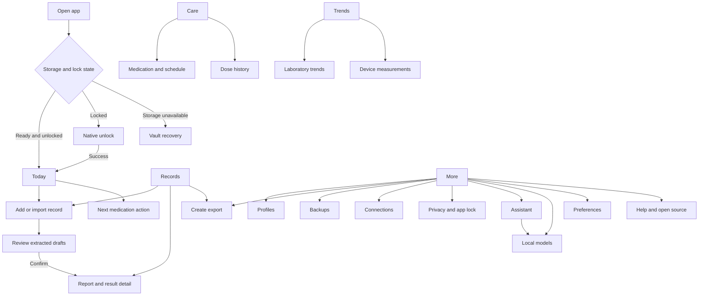

# Navigation and user flows

Design specification, 1 November 2026. The navigation is locked to **Today, Records, Care, Trends, More**. Import is an action in Today and Records. Assistant and model management are inside More. See [DESIGN_SYSTEM.md](DESIGN_SYSTEM.md) for appearance and [ACCESSIBILITY_AND_PLATFORM.md](ACCESSIBILITY_AND_PLATFORM.md) for native handoffs and adaptation.

This map reorganizes existing capabilities and identifies proposed navigation/layout improvements. It does not authorize changing clinical calculations, stored identifiers, profile ownership, licensing rules or export contents. Some dedicated pages replace functionality currently rendered inline or in dialogs. Their presentation is proposed; the underlying domain operation remains the source of truth.

The approved visual direction is Vezuna Living Color. Deep pine top bands give root screens a recognizable structure. Mint identifies Records, coral identifies Care, lavender identifies Trends, and citron highlights real activity data. Carry these colors into meaningful task/summary panels and related detail headers, with readable dark text. The same named navigation and recovery paths must work without perceiving the colors. The previous pale/plain visual direction is superseded.

## Existing route mapping

The current route enum is `AppScreen` in `shared/src/commonMain/kotlin/app/vezuna/ui/AppController.kt`.

| Original route or entry | Redesigned location | Required continuity |
|---|---|---|
| `Dashboard` | Today root | Next dose, adherence and recent records remain available for the active profile |
| `Labs` | Records root | Confirmed results and report/source associations remain intact |
| `ImportReview` | Add/import action from Today or Records; review queue under Records | Draft, confirm, edit and reject behaviors remain explicit |
| `ResultDetail(observationId)` | Records → result detail; also reachable from Today or Trends | Keep the exact observation identity and source context; Back returns to the invoking context |
| `Medications` | Care root and focused medication forms/details | Preserve schedule, dose-event and stop/delete semantics |
| `Trends` | Trends → laboratory trends | Only compatible confirmed readings are combined |
| `Vitals` | Trends → device measurements | Preserve linked-profile restrictions, available metrics and aggregation behavior |
| `Settings` | More root and grouped settings detail pages | Export, backup, security and device-health capabilities remain reachable |
| `AiChat` | More → Assistant | Local generation and existing content boundaries remain intact |
| `Models` | More → Local models; also from Assistant setup | Installed/selected/loaded/error states remain distinct |
| Dashboard inline profile management | Root profile selector → profile sheet; More → Profiles | Switching clears stale profile-specific selections and prepared exports |
| Settings PDF/CSV controls | Records → Export; More → Exports | Current confirmed-result export behavior remains available without AI |
| Settings backup dialogs | More → Backups → Create/Restore | Preserve portable/same-device formats and restore choices |
| App-lock host and vault-recovery host | Before any authenticated content | Do not make these ordinary tabs or expose data underneath them |

Native iOS entries in `ContentView.swift` map as follows: `.importSource` to Add/import, `.health` to More → Connections, `.export` to Exports/Backups as appropriate, `.license` to More → Assistant/model activation, and `.notices`/`.privacy` to More → About/privacy. They remain native integrations, not duplicate implementations of the same data operation.

## Root structure

Each of the five roots has a visible selected navigation state and a compact active-profile selector. Profile selection is global. A form or prepared export is bound to the profile shown when the task starts. Do not silently apply an in-progress task to a different profile. Complete/cancel the task or explicitly restart it for the new profile.

Retain each root's scroll/filter state where practical. Details opened from Today or Trends return there. Details opened from Records return to the same list/filter. Focused forms can hide the bottom navigation, but always provide a labeled back/cancel action. Warn about unsaved edits only when actual unsaved changes would be discarded.

## First use and opening the app

1. Open storage. Show a brief local loading state without fake health values.
2. If enabled, unlock through the native authentication flow before rendering profile data.
3. For a new household, a proposed short welcome/profile setup leads to an empty Today screen. No cloud account or social login is introduced.
4. Show useful starting actions: Add a record and Add medication. Ask for camera, notification or health permissions only when the related action needs them.

An empty Today screen uses concise guidance, not zero-valued health scores. A failed unlock returns to a neutral lock screen with Retry/Unlock. A storage failure leads to recovery choices. Retry and restore remain available; destructive reset is a separate explicitly confirmed action with its existing quarantine/recovery behavior preserved.

## Import and confirm a laboratory record

1. Today or Records → Add record → choose Camera, Photo, File/PDF, or the existing manual-entry capability.
2. Select/capture through the OS. Return to local extraction with the source filename and a real processing state.
3. Review drafts with the source accessible. Show test name, original value, unit, collection date and source reference. Mark ambiguous tokens and missing required fields beside the affected entry.
4. Confirm or reject each draft through the supported operation. Confirmation adds the result to Records and eligible trends/exports. Unconfirmed content stays visibly separate.
5. Show a useful completion message and View records action. A count must describe actual confirmed/draft results, not an assumed import success.

| Alternate state | Recovery |
|---|---|
| Picker/camera cancelled | Return to the source choices without an error or empty record |
| Unsupported, oversized or unreadable source | Explain the specific problem and allow another file; preserve any unrelated drafts |
| No extractable results | Offer a clearer image/source or manual entry. Do not fabricate extracted values |
| Missing date or ambiguous number | Keep the draft editable; show the original token/source. Do not silently choose a date or numeric interpretation |
| Save failed | Keep the reviewed input and source context for retry. Do not display Confirmed until persistence succeeds |

Source/review split panes on tablet and a dedicated source-preview page on phone are presentation improvements. They must not imply editing the original report or changing existing source retention.

## Find, edit and compare results

Records → choose report/result → detail → edit, source, trend or export. Proposed search and filter controls operate on the active profile. A search with no matches keeps the query visible and offers Clear filters; it is distinct from having no records.

Result detail gives the original value/unit priority, followed by collection date, source, reference and confirmation. A reference comparison is textual, such as Above report range. It is not a diagnosis. Edits use the existing domain validation and update dependent views only after successful saving. Deletion identifies the exact target and effect.

Trends → Laboratory → choose metric and compatible unit group → choose a period → inspect chart or values list. One reading is a point and a value, not an invented trend line. With no compatible readings, explain why and link to review or the relevant record. Qualitative results use dated text entries. Preserve each report's reference context when ranges differ.

## Manage medication and record a dose

1. Care → Add medication → enter recorded name, strength, instructions and prescribed schedule using existing fields.
2. Save the medication. Request notification authorization in context if reminders need it; saving a record must not falsely imply permission was granted.
3. Today or Care → scheduled dose → Taken, Skip or Snooze as supported. Record an event only after the explicit user action succeeds.
4. Care → medication detail/history → edit schedule, stop, or delete with the existing distinct semantics and confirmation.

No medications produces a single Add medication action. No upcoming doses for the current day is a normal state, not an error. Denied notifications keep the schedule readable and point to platform settings when available. A failed event save keeps the prior state and offers Retry. Show undo/correction only where the domain operation supports it; a design image does not authorize automatic corrections or new dosage recommendations.

## Connect device measurements

More → Connections → select the correct household profile → native HealthKit/Health Connect authorization/import → Trends → Device measurements. Also provide a Connect data action from the empty device-measurements state.

The existing metrics are heart rate, steps and weight. Keep the existing daily average/total labels where applicable. If a different profile owns the device connection, show that profile and an explicit switch/link choice; never silently attach one person's device data to another family member. Unsupported platform, no returned readings and an actual permission failure are separate states. Use neutral No readings available when the platform cannot distinguish missing data from unavailable read access.

## Prepare and share an export

1. Records or More → Exports → confirm the profile and the available scope. Proposed scope/template controls must map to implemented export rules before becoming active.
2. Choose PDF or CSV and the supported export language. Explain that only eligible confirmed records are included.
3. Prepare locally. Show an accurate error if generation fails, preserving the selection.
4. Preview the generated document and page count. Share invokes the OS share sheet; dismissing it returns to the same preview.

Do not claim the document was delivered when only preparation succeeded. An empty eligible selection directs the user to review records. Records and export remain available if models are unavailable, not installed or not licensed. The PDF-specific specification owns document content, pagination and template proposals; this flow owns navigation and recovery.

## Back up and restore

More → Backups → Create → explain the existing backup kind → enter and confirm a passphrase for the portable format → native Save. Show success only after writing completes. Cancellation returns to Backups. If passphrases mismatch or are rejected by existing validation, keep the form and identify the problem without displaying the secret in notices.

More → Backups → Restore → native Open → validate format → request passphrase if required → preview the contained profile → choose the available restore mode → restore. If the profile already exists, preserve Restore as new and Replace existing as distinct choices, with replacement consequences stated before commitment. A same-device backup must not appear portable.

Wrong passphrase keeps the retry screen; unknown/corrupt backup permits choosing another file. Do not modify current records before validation and the explicit restore decision. Partial recovery of supported data must be reported accurately, including the existing outcome where vitals were not restored. Vault-recovery entry uses the same validated restore flow with its appropriate recovery warning.

## Assistant and local models

More → Assistant → select/use an available local model → compose a question → generated response with a visible generated-content label and record context. The interface does not present generated language as a confirmed result or clinical instruction.

If no model is ready, show the reason and Open local models. Models distinguishes catalog unavailable, available, installing, installed, selected, loading, loaded and failed states using the actual runtime state. Retry applies to the failing operation. Store verification/assets can require connectivity; this does not introduce a health-data cloud. Cancelling model setup returns to More/Assistant without blocking Today, Records, Care, Trends or export.

## Cross-flow recovery rules

| Situation | Required response |
|---|---|
| User cancels an OS handoff | Restore the initiating app screen and its meaningful state; do not show a success message |
| Active profile changes | Clear stale selection/export data and render the selected profile's records. Never show a prior profile's content under a new name |
| App becomes locked | Remove sensitive content and dismiss app-owned native sheets. After unlock, restore only state still valid for the active profile |
| A mutation fails | Preserve the previous persisted state and the user's retryable input. Show the error where the task occurs |
| Model/store operation fails | Keep clinical records and export usable; do not overlay the entire app with a model entitlement block |

Proposed onboarding, search/filter affordances, dedicated detail pages, richer export configuration, and language/appearance preferences need implementation decisions. Existing storage, confirmation, medication event, backup, security and export invariants take precedence over a generated mockup.
